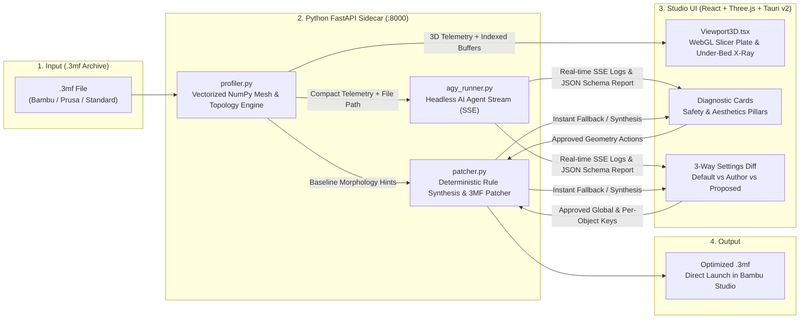

<div align="center">


# LayerZero Studio v2.0

**Universal `.3mf` AI Printability & Aesthetics Optimizer for 3D Printing**

[](LICENSE)
[](backend/)
[](frontend/)
[](frontend/src-tauri/)
[](CONTRIBUTING.md)

*Dissect any downloaded `.3mf` project using vectorized 3D mesh mathematics and your local AI agent to prevent mid-print failures, eliminate surface artifacts, and learn slicer engineering by doing.*

[Website](https://layerzero.io.vn) · [English](#overview) · [Tiếng Việt](#giới-thiệu-tiếng-việt) · [Architecture](docs/ARCHITECTURE.md) · [Contributing](CONTRIBUTING.md)

</div>

---

## Overview

When downloading `.3mf` files from MakerWorld, Printables, or Thingiverse, newcomers and makers frequently run into hidden slicer traps:
- **Pinpoint Ball-Joint Bases**: Articulated models or figurines touching the PEI build plate on a tiny `< 6 mm` curved contact patch at `Z = 0`, detaching mid-print.
- **Hidden Support Blockers & Missing Cradles**: Author-painted `paint_supports="8"` blockers left near the base or unbraced overhangs causing spaghetti failures.
- **CoreXY-to-Bed-Slinger Inertia**: Profiles saved for enclosed CoreXY machines (`10,000 mm/s²` travel acceleration, `grid` infill) knocking over tall parts on bed-slinger printers like the **Bambu Lab A1 / A1 Mini**.
- **Fragile 3D-Printed Screws & Fasteners**: Slotted screw heads splitting at Layer 1 without a brim, or snapping under torque due to 2-wall sparse infill.
- **Surface Artifacts**: Stair-stepping on domed tops, rough horizontal top faces without per-object ironing, and visible Z-seam scars on smooth cylinders.

**LayerZero Studio** solves both **Print Safety** and **Surface Aesthetics** non-destructively while teaching the user **why** each geometry and slicer parameter matters.

---

## Giới thiệu (Tiếng Việt)

**LayerZero Studio** là công cụ mã nguồn mở kết hợp giữa **Toán học Hình thái 3D (Vectorized NumPy)** và **Headless AI Agent (`agy`)** giúp người dùng máy in 3D (đặc biệt là hệ sinh thái Bambu Studio / PrusaSlicer / OrcaSlicer):
1. **Giải phẫu trực quan file `.3mf`**: Đọc trực tiếp lưới tam giác 3D, ma trận biến đổi 12-float, màu sơn đa sắc AMS (`paint_color`), vùng tô Support (`paint_supports`) và cấu hình `Metadata/*.config`.
2. **Tối ưu không phá hủy (Non-Destructive Patching)**: Tự động vạt phẳng đáy khớp cầu siêu nhỏ (`Z = 0.80mm`), bọc đài đỡ Support Enforcer 360° ở gầm, gia cố riêng ốc vít bằng Per-Object Overrides, bật Ironing cho mặt phẳng ngang và Scarf Seam cho thân trụ tròn — trong khi **giữ nguyên 100% bảng màu đa sắc AMS và tháp Prime Tower**.
3. **Vừa in vừa học (Learn by Diff)**: Đối chiếu trực quan 3 cột (**Mặc định Hệ thống** vs **File Tác giả** vs **LayerZero Đề xuất**) kèm giải thích nguyên lý cơ khí & nhiệt động học rõ ràng bằng tiếng Việt.

---

## System Architecture



For a deep dive into the coordinate math, XML namespaces, and data structures, read [**docs/ARCHITECTURE.md**](docs/ARCHITECTURE.md).

---

## Key Features

### 1. Vectorized NumPy 3D Morphology Profiler (`backend/profiler.py`)
- Analyzes **1.8M+ triangles in ~1 second** using vectorized regex + NumPy array operations.
- Supports both **Bambu Studio Production Extension** (`3D/Objects/*.model` referenced via `<component p:path="...">`) and **Standard / PrusaSlicer inline `<mesh>`** `.3mf` files.
- Computes world-space bounding boxes, Layer 1 (`Z <= 0.22mm`) vs Layer 10 (`Z <= 2.0mm`) contact footprints, triangle normal distributions, cylindrical radial symmetry scores, and painted support/extruder zones.

### 2. Unleashed Headless AI Agent (`backend/agy_runner.py`)
- Streams real-time reasoning and tool execution (`init`, `tool`, `agent_response`, `result`) to the UI via **Server-Sent Events (SSE)**.
- Enforces strict JSON output compliance against [`backend/schemas/audit_schema.json`](backend/schemas/audit_schema.json).
- Automatically falls back to the built-in deterministic **Morphology Rule Engine** when `agy` CLI is not installed, ensuring **100% offline reliability**.

### 3. Non-Destructive `.3mf` Geometry & Slicer Patcher (`backend/patcher.py`)
| Action Code | Pillar | What It Modifies |
| :--- | :--- | :--- |
| `FLATTEN_BOTTOM` | Safety | Clamps vertices below `min_z + dz` (default `0.80mm`) and shifts item/assembly Z transforms so pinpoint ball bases gain +300% Layer 1 bed contact. |
| `REINFORCE_SUPPORTS` | Safety | Strips accidental support blockers (`paint_supports="8"`) below `Z = 8mm` and paints a 360° Support Enforcer cradle (`paint_supports="4"`) on steep base overhangs. |
| `OPTIMIZE_SCREW` | Safety | Injects per-object overrides on screw/fastener objects: `5mm` brim (`0.04mm` gap), `6` wall loops, `100%` concentric infill, and `35 mm/s` outer wall speed. |
| `ROTATE_YAW` | Safety | Tunes bed-slinger Y-axis kinematics (`4000 mm/s²` acceleration, `0.8mm` Normal Lift Z-Hop, disabled infill retraction reduction). |
| `ADAPTIVE_LAYER_DOME` | Aesthetics | Sets `0.16mm` optimal layer height and per-object `concentric` top surface pattern on domed shells (`0.68 <= normal_z < 0.985`). |
| `IRONING_FLAT_TOP` | Aesthetics | Enables per-object `topmost` ironing (`12%` flow, `30 mm/s` speed, `0.15mm` spacing) strictly on objects with large flat horizontal tops (`normal_z >= 0.992`). |
| `SCARF_SEAM_CYLINDER` | Aesthetics | Enables per-object `contour` Scarf Joint Seam (`seam_slope_type`) and global `G2/G3` Arc Fitting on high-symmetry cylindrical parts. |
| `FUZZY_SKIN` | Aesthetics | Optional per-object outside matte texture (`0.3mm` point distance, `0.2mm` thickness; disabled by default). |

### 4. Interactive 3-Pane Studio & Slicer Viewport (`frontend/`)
- **Bambu-Style Back-Face Culled Build Plate**: Orbit 360° underneath the build plate (`Z < 0`) to inspect first-layer emerald contact footprints and painted support cradles unobstructed.
- **Interactive Flatten Laser Plane**: Drag the flatten slider (`0.2mm – 2.0mm`) and watch the amber laser cut plane move in real time on the 3D mesh.
- **Multi-Color AMS Preview**: Renders multi-color painted triangles directly from `.3mf` filament palettes.

---

## Repository Structure

```text
layerzero/
├── backend/                  # Python FastAPI Backend & 3D Geometry Engine
│   ├── main.py               # FastAPI REST + SSE endpoints & session lifecycle
│   ├── profiler.py           # Vectorized NumPy 3D mesh & surface topology profiler
│   ├── patcher.py            # Non-destructive .3mf XML/ZIP patcher & rule synthesis
│   ├── agy_runner.py         # Headless `agy` CLI subprocess stream runner
│   ├── requirements.txt      # Python dependencies
│   └── schemas/
│       └── audit_schema.json # Strict JSON Schema for AI diagnostic reports
├── frontend/                 # Main Studio Application (React + TypeScript + Three.js)
│   ├── src/
│   │   ├── App.tsx           # 3-pane Studio workbench, SSE client & state management
│   │   ├── types.ts          # Shared TypeScript interfaces for telemetry & audits
│   │   └── components/
│   │       └── Viewport3D.tsx # Three.js WebGL 3D build plate & mesh inspector
│   └── src-tauri/            # Tauri v2 Native Desktop Wrapper (Rust)
│       ├── src/main.rs       # Sidecar process manager & port health check
│       ├── Cargo.toml        # Rust crate manifest
│       └── tauri.conf.json   # Tauri bundle & window configuration
├── landing/                  # Product Marketing & Educational Landing Page (Vite + React)
│   └── src/                  # Interactive 3MF simulators, bento grid & diff showcase
├── docs/
│   └── ARCHITECTURE.md       # Deep-dive technical documentation
├── start.sh                  # 1-command local development launcher (Backend + Frontend)
└── build-desktop.sh          # macOS PyInstaller Sidecar + Tauri .app/.dmg builder
```

---

## Getting Started

### Prerequisites

- **Python**: `3.10+`
- **Node.js**: `18+` (with `npm`)
- **Rust & Cargo** *(Optional — only required for building the native Tauri desktop app)*
- **Bambu Studio** *(Optional — for 1-click "Open in Bambu Studio" export)*
- **`agy` CLI** *(Optional — for live LLM agent streaming; automatically falls back to the built-in NumPy Morphology Engine if absent)*

### Quick Start (Web / Local Studio Mode)

Run the entire stack (FastAPI backend on `:8000` + Vite Studio UI on `:5173`) with a single command:

```bash
./start.sh
```

`start.sh` automatically creates `backend/.venv`, installs `backend/requirements.txt`, installs `frontend/node_modules` if missing, and launches both servers. Open **[http://localhost:5173](http://localhost:5173)** in your browser.

### Manual Setup (Component by Component)

#### 1. Backend (`:8000`)

```bash
cd backend
python3 -m venv .venv
source .venv/bin/activate
pip install -r requirements.txt
uvicorn main:app --reload --host 127.0.0.1 --port 8000
```

Interactive OpenAPI documentation is available at **[http://127.0.0.1:8000/docs](http://127.0.0.1:8000/docs)**.

#### 2. Studio Frontend (`:5173`)

```bash
cd frontend
npm install
npm run dev
```

#### 3. Landing Page (`:5174`)

```bash
cd landing
npm install
npm run dev
```

---

## Building the Native Desktop App (Tauri v2)

LayerZero packages the Python FastAPI backend as a standalone **PyInstaller single-file sidecar binary** embedded inside a native **Tauri v2** application.

### macOS Build (`.app` & `.dmg`)

```bash
# Ad-hoc signed local build (works out of the box for all contributors):
./build-desktop.sh --rebuild-backend

# Or sign with your Apple Developer ID certificate:
APPLE_SIGNING_IDENTITY="Developer ID Application: Your Name (TEAMID)" ./build-desktop.sh --rebuild-backend
```

The resulting `.dmg` installer is generated at:
`frontend/src-tauri/target/release/bundle/dmg/LayerZero_2.0.0_Apple_Silicon_arm64.dmg`

---

## API Reference

| Method | Endpoint | Description |
| :--- | :--- | :--- |
| `GET` | `/api/health` | Health check returning service status and version (`2.0.0`). |
| `GET` | `/api/samples` | Lists up to 8 sample `.3mf` files in `~/Downloads` for 1-click testing. |
| `POST` | `/api/upload` | Uploads a `.3mf` file, extracts 3D mesh buffers & morphology telemetry, and synthesizes baseline audit cards. |
| `POST` | `/api/load-local` | Loads a local `.3mf` file by path and returns 3D telemetry + baseline audit. |
| `GET` | `/api/analyze/{session_id}` | Streams real-time `agy` AI analysis steps (`log`, `status`, `complete`) via `text/event-stream` (SSE). |
| `POST` | `/api/apply` | Applies user-approved geometry patches & slicer settings to generate `<name>_LayerZero_Optimized.3mf`. |
| `GET` | `/api/download/{session_id}` | Downloads the optimized `.3mf` archive for the active session. |

---

## Contributing

We welcome contributions from 3D printing enthusiasts, slicer engineers, and developers! Please read our [**Contributing Guide**](CONTRIBUTING.md) and [**Code of Conduct**](CODE_OF_CONDUCT.md) before submitting a Pull Request.

## Security

Please review [**SECURITY.md**](SECURITY.md) for our local-first privacy guarantees and instructions on reporting security vulnerabilities.

## License

Distributed under the **MIT License**. See [**LICENSE**](LICENSE) for full details.
